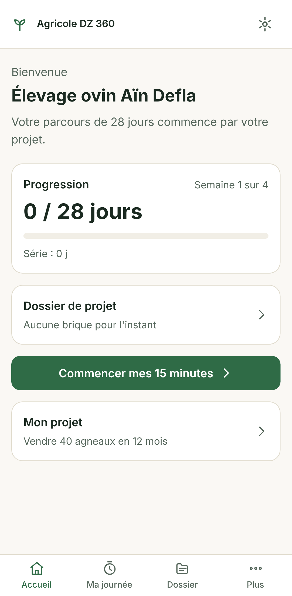
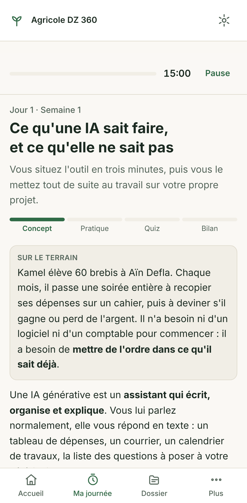
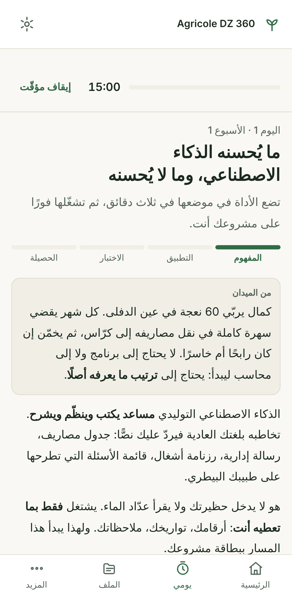

# Agricole DZ 360

**28 jours pour gérer mon projet agricole avec l'IA.**

Un parcours quotidien de 15 minutes qui apprend aux agriculteurs et aux porteurs de projets
agricoles algériens à se servir des outils d'intelligence artificielle pour organiser, planifier
et piloter leur exploitation. Aucune ligne de code n'est demandée à l'utilisateur.

L'application fonctionne **entièrement sur le téléphone**, hors ligne, sans compte et sans serveur.
Aucune donnée ne quitte l'appareil.

| Accueil | Une journée | En arabe (RTL) |
|---|---|---|
|  |  |  |

---

## Le principe

Chaque jour suit la même structure, minuteur visible à l'écran :

| Étape | Durée | Ce qu'on y fait |
|---|---|---|
| Concept | 3 min | une seule idée, expliquée avec un exemple de terrain |
| Pratique guidée | 7 min | un prompt prêt à copier, rempli avec **vos** données |
| Quiz | 3 min | trois questions, avec l'explication de chaque réponse |
| Bilan | 2 min | ce que vous retenez, et une note de confiance |

Le fil rouge est **« Mon projet »**, créé au premier jour. Chaque journée y ajoute une brique :
fiche projet, calendrier, budget, lettres, indicateurs… Au bout des 28 jours, le **Dossier de
projet** s'exporte en Word ou en tableur, et un certificat PDF clôt le parcours.

Le rythme est libre : le jour N s'ouvre dès que le jour N−1 est validé, sans attendre le lendemain.

### Ce que l'application ne fait pas

L'IA ne remplace ni l'agronome, ni le vétérinaire, ni le juriste, ni le comptable. Chaque leçon
concernée porte l'avertissement au point précis du risque : **toute dose, tout traitement, tout
texte réglementaire et tout prix se vérifie auprès d'une source locale fiable.**

Le contenu n'écrit **aucun prix** : il n'existe pas de source publique algérienne fiable et à jour,
et un montant juste aujourd'hui serait faux dans six mois. Le parcours apprend plutôt à relever ses
propres prix, à les dater et à les comparer.

---

## Démarrage

Il faut Node.js 22 ou plus récent.

```bash
npm install
npm run dev
```

L'application s'ouvre sur `http://localhost:5173/`.

### Commandes

Toutes se lancent **depuis la racine du dépôt** ; elles sont relayées vers `apps/agri28`.

| Commande | Rôle |
|---|---|
| `npm run dev` | serveur de développement |
| `npm run build` | build de production (chemin de base `/WinBest/`) |
| `npm run preview` | sert le build sur `http://127.0.0.1:4173/WinBest/` |
| `npm run verify` | types + lint + contenu + tests, en une fois |
| `npm run test` | tests unitaires (Vitest) |
| `npm run test:e2e` | tests de bout en bout (Playwright) |
| `npm run validate:content` | valide les fichiers de `content/` |
| `npm run check:bundle` | budget de poids, après un `npm run build` |

Dans `apps/agri28` uniquement : `npm run icons` (régénère les icônes PWA),
`npm run screenshots` (régénère les images de ce README, le `preview` devant tourner),
`npm run format`.

---

## Mettre à jour le contenu

**Le contenu pédagogique ne vit pas dans le code.** Corriger une phrase, ajouter une source ou
changer un outil, c'est éditer un fichier JSON dans `apps/agri28/content/` — jamais du React.

Le guide complet : **[docs/CONTENU.md](docs/CONTENU.md)**.

---

## Comptes et activation (édition APK)

L'application existe en trois **éditions**, choisies au build par `VITE_EDITION` :

| Édition | Compte | Usage |
|---|---|---|
| `complete` | aucun | développement et tests — rien n'est verrouillé |
| `apk` | obligatoire | l'application partagée en APK : essai sur les 3 premières leçons, puis activation |
| `vitrine` | aucun | le site public, limité aux 3 premières leçons |

Dans l'édition `vitrine`, les leçons 4 à 28 ne sont pas seulement masquées : **elles ne sont pas
construites**. Les masquer dans l'interface laisserait leurs fichiers téléchargeables par
quiconque regarde le trafic réseau. `npm run check:bundle` le vérifie sur les fichiers produits.

En édition `apk`, Firebase sert **uniquement** au compte : adresse email, état d'activation, dates.
Le projet, les réponses, les prompts et le Dossier ne quittent jamais le téléphone. Une fois le
compte activé, l'application n'a plus jamais besoin du réseau — perdre la connexion ne referme rien.

La mise en service du projet Firebase, les règles de sécurité et la désignation de l'administrateur
sont décrites dans **[firebase/README.md](firebase/README.md)**.

L'APK Android, sa construction et sa signature : **[docs/APK.md](docs/APK.md)**.

---

## Déploiement

L'application est publiée sur GitHub Pages **en édition vitrine** par le workflow
[`.github/workflows/deploy.yml`](.github/workflows/deploy.yml), à chaque poussée sur `master` ou
à la demande. Le site sert de démonstration et de page de téléchargement de l'APK.

Pour que le bouton de téléchargement apparaisse, définir la variable `URL_APK`
(*Settings → Secrets and variables → Actions → Variables*) avec l'adresse du fichier. Sans elle,
la page dit simplement qu'aucune version n'est encore publiée.

**À faire une seule fois** dans les réglages du dépôt :
*Settings → Pages → Build and deployment → Source = **GitHub Actions***.
Sans ce réglage, l'étape de déploiement échoue sur une erreur de permission.

L'adresse publique est alors `https://<compte>.github.io/WinBest/`. C'est elle qui impose au build
de production le chemin de base `/WinBest/`, et qui explique la copie de `index.html` en `404.html`
— sans elle, un lien profond comme `/WinBest/jour/12` renverrait une erreur 404.

Le workflow refait la vérification complète avant de publier : rien ne part en production sans que
les types, le lint, le contenu, les tests et le budget de poids soient passés.

---

## Comment c'est construit

React 19 + TypeScript strict, Vite, Tailwind CSS v4, Dexie (IndexedDB), i18next, Zod, et un service
worker Workbox. **Pas de backend, pas de télémétrie, pas de compte.**

- Le poids compte : le chargement initial fait 155 Ko gzip, et la première visite ne télécharge que
  la coque et la semaine 1. Les bibliothèques d'export et les jours 8 à 28 arrivent au premier usage.
- Le bilingue n'est pas un placage : l'arabe passe en RTL complet, exports Word compris, et des
  tests interdisent toute marge ou position physique (`margin-left`, `right`…) dans le code.
- L'accessibilité est mesurée, pas déclarée : contraste calculé sur les jetons de couleur réels,
  audits axe-core en français, en arabe et en thème sombre, parcours complet au clavier.

Les détails d'architecture sont dans **[docs/ARCHITECTURE.md](docs/ARCHITECTURE.md)**, les
conventions et le journal des décisions dans **[CLAUDE.md](CLAUDE.md)**.

```
.
├── apps/agri28/        l'application
│   ├── content/        le contenu pédagogique (JSON) — 28 jours × 2 langues
│   ├── src/domain/     la logique pure, testée à 100 %
│   ├── src/db/         le seul endroit qui connaît IndexedDB
│   ├── src/export/     Word, tableur, certificat PDF, rappel agenda
│   └── e2e/            les tests de bout en bout
└── docs/               architecture, schéma d'une leçon, guide du contenu
```

---

## Limites connues

- La disponibilité de **ChatGPT, Gemini et NotebookLM depuis l'Algérie n'a pas pu être vérifiée**.
  Ces trois outils sont marqués `a_verifier` dans `content/tools.json` et l'application le signale à
  l'utilisateur. Claude est confirmé disponible. Le contenu des 28 jours est écrit pour rester juste
  quel que soit l'outil employé.
- Le texte du certificat PDF n'est pas sélectionnable : il est dessiné en image, parce qu'aucune
  bibliothèque PDF du navigateur ne lie correctement les lettres arabes.
- Le rappel quotidien passe par un fichier d'agenda `.ics`. Sans serveur, le web ne garantit aucune
  notification programmée.
- L'anglais n'est pas encore traduit.
