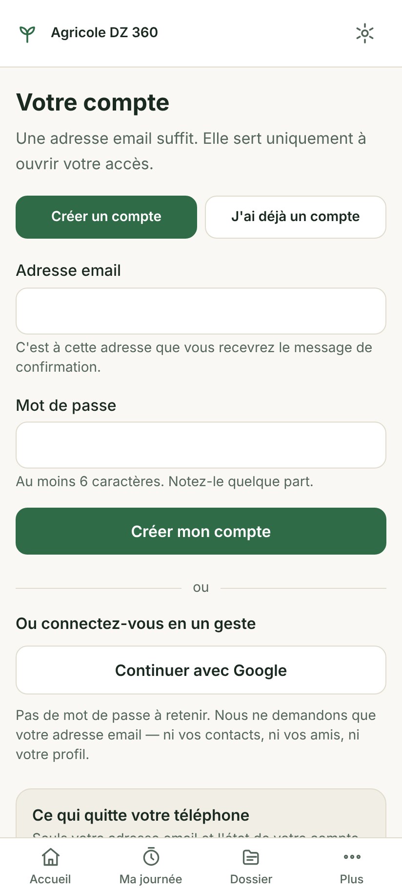

# L'application Android (APK)

L'APK se partage de la main à la main : WhatsApp, Bluetooth, carte mémoire. Il ne passe par
aucune boutique. L'application web y est **embarquée** : elle fonctionne dès le premier
lancement, sans réseau et sans hébergement.



En édition APK, un compte est obligatoire, les trois premières leçons sont offertes, et la
suite demande une activation (voir [`../firebase/README.md`](../firebase/README.md)).

---

## Construire l'APK

Onglet **Actions** du dépôt → workflow **APK** → *Run workflow*, en indiquant le numéro de
version (par exemple `1.0.0`). Le fichier est attaché à l'exécution, dans **Artifacts**.

Le workflow refait d'abord `npm run verify` : rien ne part dans un APK sans que les types, le
lint, le contenu et les tests soient passés.

> Le bouton *Run workflow* n'apparaît qu'une fois le fichier `.github/workflows/apk.yml`
> présent sur la branche par défaut (`master`).

## Signer l'APK

Un APK doit être signé pour s'installer. Le workflow fonctionne dans les deux cas et **dit
lequel s'applique**, dans le résumé de l'exécution :

| Secrets de signature | Résultat |
|---|---|
| présents | APK signé avec votre clé — **distribuable**, et remplaçable par une mise à jour |
| absents | le build **échoue**, sauf si vous cochez « autoriser_debug » au lancement |

La différence compte : une version signée en debug ne peut pas être remplacée plus tard par une
version signée avec votre clé. L'utilisateur devrait désinstaller, donc **tout perdre**. C'est
pourquoi le workflow refuse désormais de produire un APK de debug sans qu'on le lui demande
explicitement — la case existe pour un essai, pas pour une distribution.

Le résumé d'un build signé affiche l'**empreinte du certificat** (SHA-1 et SHA-256). C'est elle,
et non le numéro de version, qui décide si une mise à jour s'installera par-dessus la précédente.
Gardez-la sous les yeux : la même empreinte d'une version à l'autre, et rien à désinstaller.

### Créer le magasin de clés

Sur une machine disposant de Java (`keytool` est fourni avec le JDK) :

```bash
keytool -genkeypair -v \
  -keystore agricole360.jks \
  -alias agricole360 \
  -keyalg RSA -keysize 4096 -validity 10000 \
  -storetype PKCS12
```

L'outil demande un mot de passe et quelques informations (nom, organisation, pays : `DZ`).

**Gardez ce fichier et ce mot de passe hors ligne, en lieu sûr.** Si vous les perdez, vous ne
pourrez plus jamais publier de mise à jour installable par-dessus l'ancienne version. Il n'y a
aucun recours : c'est la clé qui prouve à Android que la mise à jour vient bien de vous.

### Déposer les secrets

Encoder le magasin en base64 :

```bash
base64 -w 0 agricole360.jks > agricole360.b64   # macOS : base64 -i agricole360.jks -o agricole360.b64
```

Puis, dans **Settings → Secrets and variables → Actions → New repository secret** :

| Secret | Contenu |
|---|---|
| `APK_KEYSTORE_BASE64` | le contenu de `agricole360.b64` |
| `APK_KEYSTORE_PASSWORD` | le mot de passe du magasin |
| `APK_KEY_ALIAS` | `agricole360` |
| `APK_KEY_PASSWORD` | le mot de passe de la clé (le même, sauf choix contraire) |
| `VITE_EMAIL_ADMIN` | l'adresse qui reçoit les demandes d'activation |
| `GOOGLE_SERVICES_JSON` | le contenu de `google-services.json` (voir « Connexion Google dans l'APK ») |

Le workflow efface la clé du serveur après l'assemblage, même en cas d'échec.

---

## Travailler sur l'APK en local

```bash
npm run apk:web        # build web en édition APK, puis copie dans le projet Android
```

Dans `apps/agri28` :

```bash
npm run apk:verifier   # sert les fichiers comme Capacitor et vérifie le comportement
npm run icons:android  # régénère icônes et écran de démarrage
```

`apk:verifier` ne remplace pas un essai sur téléphone, mais il attrape ce qui casse le plus
souvent dans un APK : un chemin de base resté sur `/AgroBest/`, un service worker encore actif,
un appel réseau au démarrage, ou le verrou de compte qui ne s'applique pas.

Assembler l'APK demande le SDK Android ; c'est le rôle de GitHub Actions.

## Ce que l'édition APK change

| | Site web | APK |
|---|---|---|
| Chemin de base | `/AgroBest/` | `/` |
| Service worker | oui | **non** — les fichiers sont déjà locaux |
| Cartes de source | oui | **non** — elles pèsent plus que le code |
| Compte | aucun | obligatoire, essai sur 3 leçons |

## Connexion Google dans l'APK

Depuis la phase 16, l'APK propose « Continuer avec Google ». Il ne passe pas par une fenêtre du
navigateur — Google refuse l'OAuth depuis une WebView embarquée (D113) — mais par le compte Google
du téléphone, via le plugin `@capacitor-firebase/authentication`.

Cela exige **une configuration déposée dans le projet Android**, et le build échoue sans elle :
le plugin initialise Firebase au démarrage, donc un APK construit sans cette configuration
planterait au lancement, pas à l'appui sur le bouton.

### Les trois choses à faire, une seule fois, dans cet ordre

**1. Récupérer l'empreinte SHA-1 de votre clé de signature.** Deux moyens :

```bash
keytool -list -v -keystore agricole360.jks -alias agricole360 | grep SHA1
```

ou bien le résumé du premier build signé, qui l'affiche (D122).

**2. Activer Google AVANT de télécharger quoi que ce soit.**

> **L'ordre n'est pas négociable**, et s'y tromper coûte un APK entier. Le client OAuth « web »
> dont le plugin a besoin n'est créé par Firebase **qu'au moment où on active Google** dans
> Authentication. Un `google-services.json` téléchargé avant cette activation ne le contient pas —
> et rien ne le signale : le build Android réussit, l'APK s'installe, puis la connexion échoue sur
> le téléphone. C'est arrivé à l'APK 1.7.0. Depuis, `npm run verifier:google-services` refuse un
> tel fichier au build (D134), mais autant ne pas provoquer l'échec.

Dans *Build → Authentication → Sign-in method*, activez **Google**. Puis seulement :

**3. Déclarer l'application Android**, et déposer le fichier obtenu :

1. [Console Firebase](https://console.firebase.google.com/) → projet `agricole360-4a470` →
   *Paramètres du projet* → *Vos applications* → **Ajouter une application** → Android ;
2. nom du paquet : **`dz.agricole360.app`** (exactement) ;
3. collez l'empreinte **SHA-1** dans le champ d'empreinte de certificat. Le libellé parle de
   « signature de débogage », ce qui prête à confusion : c'est bien là que va l'empreinte de
   votre clé de **release**, et le champ accepte plusieurs empreintes ;
4. téléchargez le **`google-services.json`** proposé à l'étape suivante ;
5. GitHub → *Settings → Secrets and variables → Actions* → nouveau secret
   **`GOOGLE_SERVICES_JSON`**, dont le contenu est le fichier entier, collé tel quel.

Pour contrôler un fichier avant de le coller, depuis `apps/agri28` :

```bash
npm run verifier:google-services -- chemin/vers/google-services.json
```

Le fichier n'est pas un secret au sens strict — il ne contient que des identifiants publics, comme
la clé d'API web (D58) — mais il désigne un projet Firebase précis, et le passer par un secret
évite qu'une copie commitée diverge sans que rien ne le signale.

Si vous ajoutez plus tard une **seconde** empreinte (par exemple en changeant de clé), il faut
l'ajouter dans la console **et** recoller le `google-services.json` mis à jour.

### Facebook reste sur le web

Le bouton Facebook n'apparaît pas dans l'APK, et c'est un choix (D127). Son SDK natif demande, en
plus de ce qui précède, un App ID et un jeton client inscrits dans les ressources Android et deux
activités déclarées au manifeste. Tant que ces valeurs n'existent pas, l'embarquer donnerait une
application qui compile et échoue à l'appui sur le bouton — pire que pas de bouton. Sur le site
web, Facebook fonctionne.

Quelqu'un qui a créé son compte sur le web **avec Facebook** et installe l'APK n'a donc pas de
mot de passe : l'écran de compte le lui dit et l'envoie vers « Mot de passe oublié ? » (D124).

## Mettre à jour sans rien perdre

Android installe une nouvelle version **par-dessus** l'ancienne, en conservant toutes les données
de l'application — donc le Dossier, la progression, les prompts et le compte — à trois conditions,
toutes les trois réunies :

1. **même identifiant de paquet** : `dz.agricole360.app`. Il est écrit dans le dépôt et ne change
   pas.
2. **même clé de signature**, c'est-à-dire la même empreinte de certificat. C'est la seule des
   trois qui peut être cassée par erreur : changer de magasin de clés, ou passer d'un APK de debug
   à un APK signé, rend la mise à jour impossible. Android répond alors « application non
   installée », et la seule issue est de désinstaller — ce qui efface tout.
3. **`versionCode` croissant**. Le workflow le prend sur `github.run_number`, qui ne redescend
   jamais : cette condition est tenue d'office.

Dit autrement : **la clé de signature se choisit une fois et ne change plus jamais.** La perdre
interdit toute mise à jour future. Sauvegardez le fichier `.jks` et ses deux mots de passe hors de
GitHub.

Côté base de données, rien à faire : la base locale se met à jour toute seule depuis n'importe
quelle version passée du schéma, et deux tests l'éprouvent sur de vraies bases
(`src/db/migration-chaine.test.ts` depuis le tout premier schéma, `src/db/migration5.test.ts`
pour le dernier saut). L'édition APK n'embarque par ailleurs aucun service worker (D61) : il n'y a
donc pas de cache à vider après une mise à jour.

### Si vos utilisateurs ont déjà un APK de debug

Les versions distribuées avant la mise en place des secrets de signature sont signées en debug.
Le premier APK signé avec votre clé **ne pourra pas** s'installer par-dessus : c'est une rupture
unique, inévitable, et elle ne se reproduira plus ensuite. Prévenez-les, et dites-leur
d'exporter leurs données avant de désinstaller — **Paramètres → Mes données → « Exporter une
sauvegarde (.json) »** — puis de les restaurer après, par « Restaurer une sauvegarde ». La
restauration remet le profil à niveau au passage, quelle que soit la version d'origine (D109).

## Installer l'APK sur un téléphone

Android refuse par défaut les applications hors boutique. À la première installation, le
téléphone propose d'autoriser la source (le gestionnaire de fichiers ou la messagerie utilisée) :
c'est une autorisation par application, et elle ne concerne qu'elle.
